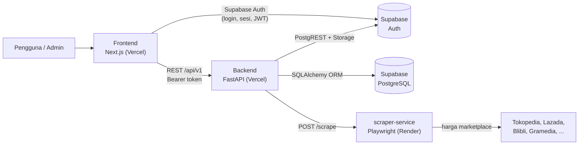

<div align="center">

# 📚 Readr — Sistem Toko Buku

**Platform toko buku online** (katalog, keranjang, pesanan, pembayaran manual,
ulasan, Book Community, Book Rewards, dan AI Book Advisor) dengan portal admin.

[](https://nextjs.org)
[](https://react.dev)
[](https://www.typescriptlang.org)
[](https://fastapi.tiangolo.com)
[](https://supabase.com)

</div>

Nama yang tampil di aplikasi adalah **Readr** (`frontend/config/site.ts`); nama
repositorinya Sistem Toko Buku.

---

## 📑 Daftar Isi

- [Tentang Proyek](#-tentang-proyek)
- [Arsitektur](#-arsitektur)
- [Fitur](#-fitur)
- [Struktur Repositori](#-struktur-repositori)
- [Prasyarat](#-prasyarat)
- [Cara Menjalankan](#-cara-menjalankan)
- [Variabel Lingkungan](#-variabel-lingkungan)
- [Rute Frontend](#-rute-frontend)
- [Endpoint Backend](#-endpoint-backend)
- [Testing & Lint](#-testing--lint)
- [Dokumentasi Lanjutan](#-dokumentasi-lanjutan)
- [Deployment](#-deployment)
- [Catatan Penting](#-catatan-penting)

---

## 🧭 Tentang Proyek

Readr terdiri dari tiga bagian yang berjalan terpisah:

| Bagian | Teknologi | Folder | Tugas |
| :--- | :--- | :--- | :--- |
| **Frontend** | Next.js (App Router), React, TypeScript, Tailwind CSS v4 | [`frontend/`](frontend) | Storefront publik + portal admin `/admin` |
| **Backend** | FastAPI, SQLAlchemy 2 (async), Supabase | [`backend/`](backend) | REST API `/api/v1`, autentikasi, otorisasi peran, logika bisnis |
| **Scraper** | Python, uv, Playwright (Chromium) | [`scraper-service/`](scraper-service) | Mengambil harga buku di marketplace Indonesia untuk fitur *Bandingkan Harga* |

Data disimpan di **Supabase (PostgreSQL)**. Autentikasi memakai **Supabase Auth**;
frontend mengirim token Bearer ke backend, dan peran (`user` / `admin`) hanya
dibaca dari kolom `profiles.role` — nilai `role` di metadata token tidak dipercaya.

Backend memakai **dua jalur akses data**: SQLAlchemy ORM untuk
`books`, `community`, `reviews`, `marketplaces`, dan `advisor`; PostgREST
(`supabase_admin` / `supabase_anon`) untuk kategori, promo, keranjang, pesanan, stok,
dashboard, pembayaran, dan rewards. Rinciannya di
[`backend/docs/packages/03-db.md`](backend/docs/packages/03-db.md).

---

## 🏗️ Arsitektur



---

## ✨ Fitur

| Fitur | Deskripsi | Dokumentasi |
| :--- | :--- | :--- |
| 🛒 **Storefront** | Katalog buku, pencarian (`q`), keranjang tamu & login, checkout dengan tarif kurir dari server | [`backend/docs/packages/06-services.md`](backend/docs/packages/06-services.md) |
| 💳 **Pembayaran manual** | Unggah bukti transfer → `under_review` → admin menyetujui/menolak; riwayat bukti dan audit log | [`backend/docs/packages/11-migrations-supabase.md`](backend/docs/packages/11-migrations-supabase.md) |
| ⭐ **Ulasan** | Ulasan buku dari pengguna, moderasi admin, ulasan disetujui memberi poin Rewards | [`backend/docs/packages/06-services.md`](backend/docs/packages/06-services.md) |
| 💬 **Book Community** | Grup diskusi publik/privat, anggota & peran, pesan real-time lewat Supabase Realtime | [`backend/COMMUNITY.md`](backend/COMMUNITY.md) *(lihat catatan di bawah)* |
| 🎁 **Book Rewards** | Ledger poin (mutasi, aturan reward, penyesuaian admin, rekonsiliasi) | [`backend/docs/packages/09-services-rewards.md`](backend/docs/packages/09-services-rewards.md) |
| 🤖 **AI Book Advisor** | Rekomendasi buku berbasis chat; penagihan lewat ledger poin | [`backend/BOOK-ADVISOR.md`](backend/BOOK-ADVISOR.md) |
| 📝 **Ulasan AI** | Ringkasan buku dengan tingkat spoiler (`no_spoiler`, `low`, `medium`, `heavy`) | [`backend/docs/packages/10-services-advisor.md`](backend/docs/packages/10-services-advisor.md) |
| 🔍 **Bandingkan Harga** | Harga buku di beberapa marketplace via `scraper-service`, disimpan sebagai snapshot | [`backend/docs/packages/08-services-marketplace.md`](backend/docs/packages/08-services-marketplace.md) |
| 🛡️ **Portal Admin** | Dashboard KPI, produk, inventori, pesanan, pelanggan, promo, pembayaran, laporan, rewards, sumber marketplace | [Rute Frontend → Admin](#-portal-admin-admin) |

> **[Catatan]** `backend/COMMUNITY.md` dan `backend/IMPLEMENTASI-4-PILAR-OOP.md`
> terhapus di working tree pada snapshot terakhir (`git status`), tetapi **belum
> di-commit**. Selama penghapusan itu belum di-commit, tautan di atas masih
> berlaku di branch ini; di `main` keduanya masih ada.

> **[Catatan]** Pola `docs` di `.gitignore` root juga meng-ignore **setiap** folder
> bernama `docs` di mana pun, termasuk `backend/docs/` — sehingga dokumen di
> [`backend/docs/packages/`](backend/docs/packages/README.md) ada di mesin lokal
> tetapi **tidak akan muncul di GitHub** sampai aturan itu dipersempit
> (mis. `/docs` untuk root saja).

---

## 🗂️ Struktur Repositori

```text
Sistem-Toko_Buku/
├── README.md              # Dokumen ini
├── render.yaml            # Blueprint Render untuk scraper-service
├── backend/               # API FastAPI
│   ├── app/               #   api/ core/ db/ models/ schemas/ services/
│   ├── migrations/        #   revisi Alembic
│   ├── tests/             #   pytest
│   ├── supabase/          #   SQL awal (arsip historis, jangan dijalankan)
│   ├── docs/packages/     #   penjelasan per paket
│   ├── api/index.py       #   entrypoint Vercel
│   └── README.md          #   dokumentasi backend
├── frontend/              # Next.js App Router
│   ├── app/               #   rute halaman + /admin
│   ├── components/        #   komponen UI
│   ├── lib/               #   api.ts, services/, supabase.ts, apiUrl.ts
│   ├── config/            #   site.ts (nama toko, tautan, sosial)
│   └── README.md          #   dokumentasi frontend
└── scraper-service/       # Playwright scraper harga marketplace
```

---

## ✅ Prasyarat

- **Python ≥ 3.12** ([uv](https://docs.astral.sh/uv/)) — untuk backend dan scraper
- **Bun ≥ 1.3** (atau Node.js ≥ 20 + npm) — untuk frontend
- **Proyek Supabase** dengan Auth aktif, database PostgreSQL, dan Storage
- Akun/API key opsional: Google Books, Gemini, OpenRouter, dan token scraper

---

## 🚀 Cara Menjalankan

### 1. Backend (FastAPI)

```bash
cd backend
uv sync
cp .env.example .env        # PowerShell: Copy-Item .env.example .env
# isi Supabase/PostgreSQL di .env (lihat tabel variabel lingkungan)
uv run alembic upgrade head # jalankan migrasi database
uv run main.py              # http://localhost:8000 — selalu --reload
```

| URL | Keterangan |
| :--- | :--- |
| `http://localhost:8000/health` | Health check |
| `http://localhost:8000/docs` | Swagger UI |
| `http://localhost:8000/redoc` | ReDoc |
| `http://localhost:8000/api/v1/openapi.json` | Spesifikasi OpenAPI |

> ⚠️ **Jangan jalankan `alembic upgrade head` pada database kosong.** Rantai
> migrasi saat ini **tidak dapat membangun database dari nol** (revisi
> `20261011_04` memakai `is_admin()` yang baru dibuat di `20261011_05`, dan
> tabel `categories` tidak pernah dibuat oleh migrasi). Database live adalah
> acuan. Detail: [`backend/docs/packages/11-migrations-supabase.md`](backend/docs/packages/11-migrations-supabase.md).

### 2. Frontend (Next.js)

```bash
cd frontend
bun install
cp .env.example .env        # PowerShell: Copy-Item .env.example .env
bun run dev                 # http://localhost:3000
```

`NEXT_PUBLIC_API_URL` boleh dikosongkan saat pengembangan: URL backend
diturunkan dari host halaman (`frontend/lib/apiUrl.ts`) dengan port `8000`,
sehingga membuka `http://192.168.1.10:3000` dari HP di Wi-Fi yang sama otomatis
memanggil `http://192.168.1.10:8000/api/v1`.

```text
NEXT_PUBLIC_SUPABASE_URL=https://xxxxx.supabase.co
NEXT_PUBLIC_SUPABASE_ANON_KEY=your-anon-key
# NEXT_PUBLIC_API_URL=http://localhost:8000/api/v1
```

### 3. Scraper Service (opsional — untuk *Bandingkan Harga*)

Hanya diperlukan bila ingin harga marketplace nyata; tanpa service ini, backend
tetap berjalan dan menampilkan harga terakhir yang tersimpan. Lihat
[`scraper-service/README.md`](scraper-service/README.md) dan
[`render.yaml`](render.yaml).

### 4. Akun admin

Daftar lewat `/register`, lalu promosikan akun di Supabase SQL Editor:

```sql
UPDATE public.profiles SET role = 'admin' WHERE id = 'SUPABASE_USER_UUID';
```

Bucket Storage privat **`payment-proofs`** tidak dibuat oleh migrasi — buat manual
lewat Dashboard/Supabase SQL Editor sebelum menguji unggahan bukti pembayaran.

---

## 🔧 Variabel Lingkungan

Nilai lengkap beserta komentar ada di [`backend/.env.example`](backend/.env.example)
dan [`frontend/.env.example`](frontend/.env.example). Jangan commit berkas `.env`.

### Backend (`backend/.env`)

| Kelompok | Variabel |
| :--- | :--- |
| Supabase | `SUPABASE_URL`, `SUPABASE_ANON_KEY`, `SUPABASE_SERVICE_ROLE_KEY`, `SUPABASE_JWT_SECRET` |
| Database | `DATABASE_URL` (pakai **Supavisor pooler**, bukan `db.<ref>.supabase.co`), `DATABASE_POOL_RECYCLE_SECONDS` |
| Server | `ENVIRONMENT`, `HOST`, `PORT`, `FRONTEND_ORIGINS` |
| Storage | `STORAGE_BUCKET_PRODUCTS` |
| AI | `GEMINI_*`, `OPENROUTER_*` |
| Pencarian buku | `GOOGLE_BOOKS_API_KEY` |
| Scraper | `SCRAPER_SERVICE_URL`, `SCRAPER_API_TOKEN`, `SCRAPER_TIMEOUT_SECONDS` |

### Frontend (`frontend/.env`)

| Variabel | Wajib | Keterangan |
| :--- | :--- | :--- |
| `NEXT_PUBLIC_SUPABASE_URL` | ✅ | URL proyek Supabase |
| `NEXT_PUBLIC_SUPABASE_ANON_KEY` | ✅ | Anon key (aman untuk browser) |
| `NEXT_PUBLIC_API_URL` | Opsional | URL backend. Kosong = diturunkan dari host halaman. **Wajib** diisi saat deploy |
| `NEXT_DEV_ALLOWED_ORIGINS` | Opsional | Hanya `next dev`: host tambahan untuk akses via LAN |

---

## 🗺️ Rute Frontend

### 🌐 Publik & Pengguna

| Rute | Berkas | Deskripsi |
| :--- | :--- | :--- |
| `/` | `app/page.tsx` | Katalog utama: hero, pencarian, filter kategori (pencocokan kata kunci di sisi klien), keranjang |
| `/books/[id]` | `app/books/[id]/page.tsx` | Detail buku, bandingkan harga marketplace, ulasan, ulasan AI |
| `/login` | `app/login/page.tsx` | Masuk (Supabase Auth) |
| `/register` | `app/register/page.tsx` | Daftar akun |
| `/forgot-password` | `app/forgot-password/page.tsx` | Kirim tautan reset kata sandi |
| `/reset-password` | `app/reset-password/page.tsx` | Formulir kata sandi baru (menukar sesi recovery) |
| `/auth/callback` | `app/auth/callback/` | Penukaran kode autentikasi |
| `/checkout` | `app/checkout/page.tsx` | Keranjang, alamat, kurir, metode bayar, konfirmasi pesanan |
| `/orders` | `app/orders/page.tsx` | Daftar pesanan pengguna |
| `/orders/[id]` | `app/orders/[id]/page.tsx` | Detail pesanan, status pembayaran, unggah bukti transfer |
| `/komunitas` | `app/komunitas/page.tsx` | Book Community (grup diskusi & chat real-time) |
| `/poin` | `app/poin/page.tsx` | Saldo poin, mutasi, riwayat aktivitas reward |
| `/support` | `app/support/page.tsx` | Pusat Bantuan / FAQ |
| `/privacy` | `app/privacy/page.tsx` | Kebijakan Privasi |
| `/terms` | `app/terms/page.tsx` | Ketentuan Layanan |

### 🛡️ Portal Admin (`/admin`)

Akses dijaga `app/admin/layout.tsx` (kelengkapan UX) **dan** `require_admin` di
backend (penentu sebenarnya). Rute tanpa halaman index sendiri
(`/admin/pembayaran/[paymentId]`) adalah halaman detail.

| Rute | Deskripsi |
| :--- | :--- |
| `/admin` | Pengalihan ke `/admin/dashboard` |
| `/admin/dashboard` | KPI penjualan, grafik, pesanan terkini, stok menipis |
| `/admin/produk` | Manajemen katalog buku (tambah/edit/hapus, unggah sampul) |
| `/admin/inventori` | Stok kritis & penyesuaian stok |
| `/admin/pesanan` | Status pesanan & resi kurir |
| `/admin/pembayaran` | Verifikasi bukti pembayaran manual |
| `/admin/pembayaran/[paymentId]` | Detail pembayaran: setujui/tolak + riwayat bukti |
| `/admin/pelanggan` | Data pembeli — **diturunkan dari daftar pesanan** (`customerService`), belum ada endpoint daftar pengguna |
| `/admin/promo` | Kupon & diskon |
| `/admin/laporan` | Laporan bulanan, grafik penjualan & kategori |
| `/admin/rewards` | Aturan reward, aktivitas, penyesuaian poin, rekonsiliasi |
| `/admin/marketplace-sources` | Sumber harga marketplace per buku |
| `/admin/pengaturan` | Halaman pengaturan UI — **backend belum memiliki endpoint** pengaturan/notifikasi |

---

## 🔌 Endpoint Backend

Semua endpoint aplikasi berada di bawah **`/api/v1`** (`API_V1_PREFIX`).
Kolom **Akses**: 🔓 publik · 🔑 login (Bearer) · 🛡️ admin.

### Umum & Autentikasi

| Method | Endpoint | Akses | Keterangan |
| :--- | :--- | :--- | :--- |
| `GET` | `/health` | 🔓 | Health check (`/health`, **bukan** di bawah `/api/v1`) |
| `GET` | `/api/v1/me` | 🔑 | Profil + role pemanggil (alias `GET /api/v1/auth/me`) |
| `POST` | `/api/v1/auth/login` | 🔓 | Masuk |
| `POST` | `/api/v1/auth/register` | 🔓 | Registrasi |

### Katalog & Inventori

| Method | Endpoint | Akses | Keterangan |
| :--- | :--- | :--- | :--- |
| `GET` | `/api/v1/books?page=&page_size=&q=` | 🔓 | Daftar buku (tanpa filter kategori di backend) |
| `GET` | `/api/v1/books/{book_id}` | 🔓 | Detail buku |
| `POST` / `PUT` / `PATCH` / `DELETE` | `/api/v1/books` · `/api/v1/books/{book_id}` | 🛡️ | Buat, ubah, hapus buku |
| `GET` | `/api/v1/categories` | 🔓 | Daftar kategori |
| `GET` | `/api/v1/categories/{category_id}` | 🔓 | Detail kategori |
| `POST` / `PUT` / `DELETE` | `/api/v1/categories…` | 🛡️ | Kelola kategori |
| `POST` | `/api/v1/uploads/product-image` | 🛡️ | Unggah sampul produk |
| `GET` | `/api/v1/inventory/movements` · `/low-stock` | 🛡️ | Mutasi stok & stok menipis |
| `POST` | `/api/v1/inventory/adjust` | 🛡️ | Penyesuaian stok |

### Keranjang, Pesanan & Pembayaran

| Method | Endpoint | Akses | Keterangan |
| :--- | :--- | :--- | :--- |
| `GET` / `POST` / `PATCH` / `DELETE` | `/api/v1/cart…` | 🔑 | Keranjang server (`/items`, `/merge`) |
| `GET` | `/api/v1/shipping-options` | 🔓 | Layanan kurir & tarif (sumber kebenaran checkout) |
| `GET` | `/api/v1/orders` | 🔑 | Daftar pesanan (admin: semua, pelanggan: miliknya) |
| `POST` | `/api/v1/orders` | 🔑 | Buat pesanan |
| `GET` | `/api/v1/orders/{order_id}` | 🔑 | Detail pesanan |
| `PATCH` | `/api/v1/orders/{order_id}/status` | 🛡️ | Ubah status pesanan |
| `POST` | `/api/v1/orders/expire-overdue` | 🛡️ | Batalkan pesanan `pending` yang kedaluwarsa |
| `GET` | `/api/v1/orders/{order_id}/payment` | 🔑 | Instruksi & status pembayaran |
| `GET` | `/api/v1/orders/{order_id}/payment/proofs` | 🔑 | Riwayat bukti transfer |
| `POST` | `/api/v1/orders/{order_id}/payment/proof` | 🔑 | Unggah/ganti bukti → `under_review` |
| `GET` / `POST` | `/api/v1/admin/payments…` | 🛡️ | Daftar, detail, setujui, tolak |

### Promo & Dashboard

| Method | Endpoint | Akses | Keterangan |
| :--- | :--- | :--- | :--- |
| `GET` / `POST` / `PATCH` / `DELETE` | `/api/v1/promos…` | 🛡️ | Kupon & diskon |
| `GET` | `/api/v1/dashboard/summary` | 🛡️ | KPI |
| `GET` | `/api/v1/dashboard/sales-chart` | 🛡️ | Grafik penjualan |
| `GET` | `/api/v1/dashboard/categories-chart` | 🛡️ | Grafik per kategori |
| `GET` | `/api/v1/dashboard/reports/monthly` | 🛡️ | Laporan bulanan |

### Marketplace, Rewards, Community, Ulasan & AI

| Method | Endpoint | Akses | Keterangan |
| :--- | :--- | :--- | :--- |
| `GET` | `/api/v1/books/{book_id}/marketplace-prices` | 🔑 | Bandingkan harga satu buku |
| `GET` | `/api/v1/marketplaces` | 🛡️ | Marketplace yang didukung |
| `GET` / `POST` / `PATCH` / `DELETE` | `/api/v1/marketplace-sources…` · `/books/{id}/marketplace-sources/seed` | 🛡️ | Sumber harga per buku |
| `GET` | `/api/v1/rewards/me` · `/transactions` · `/spoiler-access` | 🔑 | Saldo poin, mutasi, akses spoiler |
| `GET` / `PATCH` / `POST` | `/api/v1/admin/rewards…` (`rules`, `adjustments`, `backfill`, `reconcile`, `activities`, `ai/recover`) | 🛡️ | Kelola reward |
| `GET` / `POST` | `/api/v1/community/groups…` | 🔑 | Grup, anggota, pesan (buat grup: 🛡️) |
| `GET` | `/api/v1/books/{book_id}/reviews` | 🔓 | Ulasan tayang + rata-rata rating |
| `POST` | `/api/v1/books/{book_id}/reviews` | 🔑 | Tulis ulasan (selalu `pending`) |
| `GET` / `PATCH` | `/api/v1/reviews…` | 🔑 / 🛡️ | Ulasan milik pengguna, moderasi admin |
| `POST` | `/api/v1/ai/books/{book_id}/review` | 🔑 | Ulasan AI (level berbayar memakai poin/syarat beli) |
| `GET` | `/api/v1/ai/books/{book_id}/access` · `/ai/reviews…` | 🔑 | Syarat tiap tingkat spoiler, hasil tersimpan |
| `GET` / `POST` / `PATCH` | `/api/v1/book-advisor…` (`pricing`, `chat`, `sessions`, `preferences`, `feedback`) | 🔑 | AI Book Advisor |

> `POST /api/v1/books/{book_id}/ai-review` masih ada sebagai **alias lama
> (`deprecated`)**. Frontend memakainya hanya untuk level gratis tanpa token.
> Daftar route lengkap per modul: [`backend/docs/packages/01-api.md`](backend/docs/packages/01-api.md).

---

## 🧪 Testing & Lint

### Frontend

```bash
cd frontend
bun run test       # vitest (jsdom)
npx tsc --noEmit   # TypeScript
npm run lint       # ESLint
bun run build      # next build
```

### Backend

```bash
cd backend
uv run pytest          # test memakai dependency override & repository palsu (tanpa DB)
uv run ruff check .
```

### Scraper Service

```bash
cd scraper-service
uv run python selftest.py
```

---

## 📚 Dokumentasi Lanjutan

| Dokumen | Isi |
| :--- | :--- |
| [`backend/README.md`](backend/README.md) | Menjalankan backend, migrasi, deployment Vercel |
| [`backend/docs/packages/README.md`](backend/docs/packages/README.md) | Indeks penjelasan **per paket** backend (14 dokumen) |
| [`backend/IMPLEMENTASI-4-PILAR-OOP.md`](backend/IMPLEMENTASI-4-PILAR-OOP.md) | Pola OOP/SOLID lintas paket *(lihat catatan di bagian Fitur)* |
| [`backend/BOOK-ADVISOR.md`](backend/BOOK-ADVISOR.md) | AI Book Advisor |
| [`backend/COMMUNITY.md`](backend/COMMUNITY.md) | Book Community *(lihat catatan di bagian Fitur)* |
| [`frontend/README.md`](frontend/README.md) | Menjalankan frontend |
| [`scraper-service/README.md`](scraper-service/README.md) | Scraper harga marketplace |
| [`frontend/AGENTS.md`](frontend/AGENTS.md) | Aturan kerja di dalam folder frontend |

---

## ☁️ Deployment

| Bagian | Platform | Konfigurasi |
| :--- | :--- | :--- |
| Frontend | Vercel | [`frontend/vercel.json`](frontend/vercel.json) — `bun install --frozen-lockfile`, `bun run build` |
| Backend | Vercel | [`backend/vercel.json`](backend/vercel.json) → [`backend/api/index.py`](backend/api/index.py); `/docs` & OpenAPI dimatikan bila `VERCEL` ada |
| Scraper | Render | [`render.yaml`](render.yaml) — Web Service Docker; minimal plan `standard` (Chromium ≥ 1 GB RAM) |

Set variabel `NEXT_PUBLIC_*` di Vercel **sebelum build** (nilai di-inline saat build),
dan jalankan migrasi dari mesin lokal — bukan dari deployment serverless.

---

## ⚠️ Catatan Penting

- **Database live adalah acuan migrasi.** Skema di Supabase tidak identik dengan
  `backend/supabase/*.sql` (arsip) maupun dengan model ORM; beberapa objek dibuat
  manual. Jangan mengubah database/aplikasi tanpa memastikan keadaan sebenarnya.
- **`backend/supabase/` bersifat arsip historis** — lihat `backend/supabase/README.md`.
- **Otorisasi tidak bergantung pada RLS** untuk jalur service-role: penentunya
  dependency `require_admin` / `require_user` di backend.
- **Filter kategori di storefront berjalan di sisi klien**; `GET /books` hanya
  menerima `page`, `page_size`, dan `q`.
- **Halaman `/admin/pengaturan` belum tersambung ke backend** — form-nya
  menampilkan pesan bahwa perubahan belum tersimpan.
