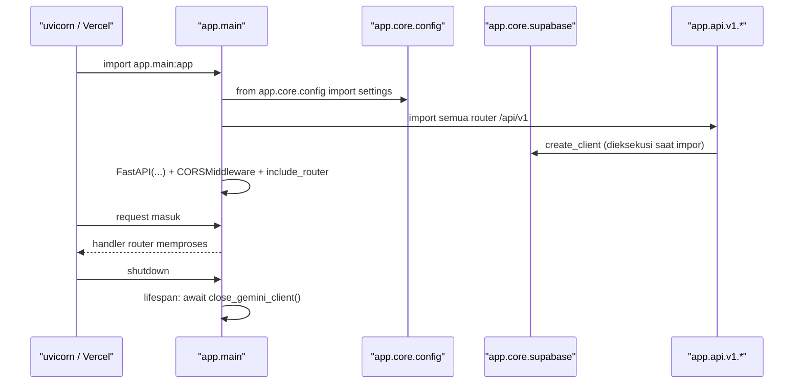

# 00 — Akar `backend/` dan Konfigurasi Proyek

Dokumen ini membahas berkas yang **berada langsung di `backend/`** (bukan di
dalam paket `app/`): titik masuk aplikasi, konfigurasi build/deploy, dan
dokumen proyek.

---

## 1. Posisi di arsitektur

`backend/` adalah **root proyek Python** sekaligus direktori kerja proses
`uvicorn`. Isinya dua kelompok:

1. **Kode titik masuk** — `main.py` (lokal) dan `api/index.py` (Vercel).
2. **Konfigurasi & dokumentasi** — `alembic.ini`, `pyproject.toml`,
   `requirements.txt`, `vercel.json`, `.vercelignore`, `.gitignore`,
   `.python-version`, `.env` / `.env.example`, dan berkas `*.md`.

**[Fakta]** Kedua titik masuk mengarah ke objek yang sama: `app.main:app`.
Tidak ada logika aplikasi yang tinggal di akar backend.

---

## 2. Tabel berkas

| Berkas | Tujuan | Isi utama |
|--------|--------|-----------|
| `main.py` | Runner lokal | `run()` memanggil `uvicorn.run("app.main:app", host=settings.HOST, port=settings.PORT, reload=True)`; dijalankan lewat blok `if __name__ == "__main__":`. |
| `api/index.py` | Entrypoint Vercel (serverless) | Menyisipkan direktori induk ke `sys.path`, `from app.main import app`; bila variabel lingkungan `VERCEL` ada, mematikan `openapi_url`, `docs_url`, `redoc_url` (alasan di docstring: beberapa SDK mengisi signature SSL dengan `inspect.signature` yang di Python 3.14 memicu `PydanticInvalidForJsonSchema` saat `/docs` membuat skema). Vercel hanya mengenali variabel `app`. |
| `alembic.ini` | Konfigurasi Alembic | Menunjuk `migrations/env.py` sebagai skrip migrasi; URL DB diambil dari kode (`settings.database_url`), bukan dari `alembic.ini`. |
| `pyproject.toml` | Metadata & alat | Konfigurasi `ruff`, `pytest` (lihat doc 12). |
| `requirements.txt`, `uv.lock` | Dependensi | `requirements.txt` untuk instalasi pip; `uv.lock` hasil `uv`. |
| `vercel.json`, `.vercelignore` | Deploy Vercel | Routing ke `api/index.py`, berkas yang tidak ikut diunggah. |
| `.gitignore` | Git | Menyembunyikan `.env`, cache, `.venv`, dan folder `docs` (lihat catatan di §4). |
| `.python-version` | Versi Python | Dipakai `uv`/tooling. |
| `.env`, `.env.example` | Konfigurasi runtime | Dibaca `Settings` di `app/core/config.py`. `.env.example` mendokumentasikan **nama** variabel (mis. `SUPABASE_URL`, `DATABASE_URL`, `GEMINI_API_KEY`, `OPENROUTER_API_KEY`, `SCRAPER_SERVICE_URL`). **Nilai aslinya tidak ditampilkan di dokumen ini.** |
| `README.md` | Ringkasan proyek | Cara menjalankan, daftar fitur. |
| `BOOK-ADVISOR.md`, `COMMUNITY.md` | Desain fitur | Latar belakang + aturan fitur Book Advisor dan Book Community. |
| `IMPLEMENTASI-4-PILAR-OOP.md` | Materi OOP | Uraian empat pilar OOP dengan contoh dari proyek ini. Melengkapi `docs/OOP_IMPLEMENTATION.md`. |
| `docs/` | Dokumentasi | `OOP_IMPLEMENTATION.md` + folder `packages/` (dokumen per paket ini). |

---

## 3. Alur startup (fakta)

**[Fakta]** `supabase_admin` dan `supabase_anon` dibuat **saat modul diimpor**
(`app/core/supabase.py`, baris `create_client(...)` di level modul), bukan saat
request pertama. Konsekuensinya, nilai `SUPABASE_URL` dan key-nya harus valid
saat proses start, dan pengujian mengganti objek ini lewat monkeypatch.

**[Evaluasi]** Ini pola *module singleton* yang sederhana dan cepat, tetapi
membuat inisialisasi klien sulit dikontrol per-request. Untuk tes, semua jalur
harus me-monkeypatch `supabase_admin` — hal ini memang dilakukan di `tests/`.

---

## 4. Catatan git (fakta)

**[Fakta]** `.gitignore` di root **repo** (bukan `backend/`) memuat baris `docs`,
sehingga folder `backend/docs/` — termasuk dokumen ini — **tidak dilacak git**.
Untuk memasukkannya ke commit diperlukan `git add -f backend/docs`.

---

## 5. Evaluasi & rekomendasi

**[Evaluasi]** Pemisahan "runner lokal" (`main.py`) dan "entrypoint serverless"
(`api/index.py`) jelas dan tidak menduplikasi logika.

**[Rekomendasi]** Bila `/docs` suatu saat dibutuhkan di Vercel, pindahkan
penonaktifan ke `app/main.py` dengan kondisi `settings.ENVIRONMENT`, sehingga
perilakunya terdokumentasi di satu tempat alih-alih di entrypoint deploy.
