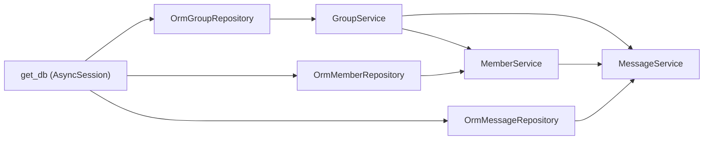

# 07 — Paket `app/services/community/`

`app/services/community/` adalah paket service **Book Community**: grup diskusi,
anggotanya, dan pesan. Paket ini memakai **SQLAlchemy ORM** dan menyusun objek
per-request lewat dependency injection di `app/api/v1/community.py`.

Docstring paket menyebut pembagiannya: `permissions` (aturan murni),
`repository` (satu-satunya jalur SQL), `errors` (kode HTTP + pesan),
`rate_limit` (pembatas in-memory), dan `group_service` / `member_service` /
`message_service` (orkestrasi).

---

## 1. Struktur (fakta)

| Berkas | Baris | Simbol utama | Tanggung jawab |
|--------|------:|--------------|----------------|
| `__init__.py` | — | Docstring pembagian tanggung jawab | Dokumentasi paket |
| `permissions.py` | 130 | `ROLE_OWNER`, `ROLE_MODERATOR`, `ROLE_MEMBER`, `can_create_group`, `can_delete_message`, `can_moderate_prompt`, `can_mark_helpful`, ... | Matriks izin **murni**, tanpa I/O |
| `errors.py` | 117 | `CommunityError(status_code, message)`, factory `not_found_group()`, ... | Error domain tanpa impor FastAPI |
| `repository.py` | 617 | `OrmGroupRepository`, `OrmMemberRepository`, `OrmMessageRepository`, `OrmInteractionRepository` | Satu-satunya jalur SQL (`AsyncSession`) |
| `rate_limit.py` | 78 | `MAX_MESSAGES_PER_WINDOW = 10`, `WINDOW_SECONDS = 10.0`, `SendRateLimiter` | Jendela geser per `(user_id, group_id)` |
| `group_service.py` | 248 | `_user_uuid`, `_is_admin`, `summary_from_row`, `detail_from_row`, `GroupService` | Grup: `list`, `detail`, `create`, `update`, `delete`, `join`, `leave`, `load_visible`, `lock`, `commit`, `rollback` |
| `member_service.py` | 196 | `_member_read`, `MemberService` | Anggota: `list_members`, `search_users`, `add_member`, `remove_member`, `change_role`, `transfer_owner`, `_require_manager` |
| `message_service.py` | 337 | `encode_cursor`, `decode_cursor`, `_message_read`, `MessageService` | Pesan: `list_messages`, `send_message`, `delete_message`, `moderate_message`, `mark_helpful` |

---

## 2. Penyusunan per-request (fakta)

```python
# app/api/v1/community.py
def get_group_service(db: Db) -> GroupService:
    return GroupService(OrmGroupRepository(db))

def get_member_service(
    db: Db, groups: Annotated[GroupService, Depends(get_group_service)]
) -> MemberService:
    return MemberService(groups, OrmMemberRepository(db))

def get_message_service(
    db: Db,
    groups: Annotated[GroupService, Depends(get_group_service)],
    members: Annotated[MemberService, Depends(get_member_service)],
) -> MessageService:
    return MessageService(groups, members, OrmMessageRepository(db))
```



**[Fakta]** Semua repository memakai **satu** sesi per-request dari `get_db`.
Transaksi dipegang oleh `GroupService`: `lock()`, `commit()`, `rollback()`
memakai baris yang sudah dimuat (`load_visible`) sebagai penanda transaksi.

**[Evaluasi]** Ini pola *constructor injection* paling bersih di basis kode:
tidak ada singleton, tidak ada akses global, dan tes menyuntikkan repository
palsu lewat `dependency_overrides` (`tests/test_community.py`,
`tests/test_community_moderation.py`).

---

## 3. `permissions.py` — aturan tanpa I/O (fakta)

**[Fakta]** Docstring modul memuat tabel matriks izin (role × aksi). Contoh
fungsi nyata:

```python
# app/services/community/permissions.py
def can_create_group(is_admin: bool) -> bool:
    """Hanya admin global yang membuat grup (keputusan produk)."""
    return is_admin

def can_delete_message(
    my_role: str | None, is_admin: bool, is_sender: bool
) -> bool:
    """Pengirim selalu boleh; moderator/owner/admin boleh menghapus pesan lain."""
    return is_sender or is_admin or my_role in (ROLE_OWNER, ROLE_MODERATOR)

def can_moderate_prompt(
    my_role: str | None, is_admin: bool, is_sender: bool
) -> bool:
    ...
    if is_sender:
        return False
    return is_admin or my_role in (ROLE_OWNER, ROLE_MODERATOR)

def can_mark_helpful(my_role: str | None, is_sender: bool) -> bool:
    return my_role is not None and not is_sender
```

**[Evaluasi]** Modul ini tidak mengimpor SQLAlchemy maupun FastAPI, sehingga
aturan bisa diuji tanpa DB (`tests/test_community.py::test_permission_matrix`).

**[Rekomendasi]** Setiap aturan baru masuk sini, bukan ke dalam query repository.

---

## 4. `errors.py` — hierarki error domain (fakta)

**[Fakta]** `CommunityError` membawa `status_code` dan `message`, lalu router
menerjemahkannya:

```python
# app/api/v1/community.py
def _http(exc: CommunityError) -> HTTPException:
    return HTTPException(status_code=exc.status_code, detail=exc.message)
```
Docstring modul menjelaskan pilihan status (404 untuk menyembunyikan eksistensi,
403 untuk aksi terlarang pada resource terlihat, 409 untuk konflik aturan).

**[Evaluasi]** Aturan "service tidak mengimpor FastAPI" dipatuhi.

---

## 5. Catatan fungsional (fakta)

| Aspek | Fakta kode |
|-------|-----------|
| Pagination | Keyset via `encode_cursor`/`decode_cursor` (pasangan `created_at` + `message_id`) |
| Idempotensi kirim | `client_message_id` duplikat mengembalikan pesan lama (`send_message`) |
| Rate limit | `SendRateLimiter` — `10` pesan / `10` detik per `(user_id, group_id)`, in-memory per proses |
| Moderation | `moderate_message` (setujui/tolak kontribusi) dan `mark_helpful`; `ChatMessageHelpfulMark` PK komposit |
| Reward hook | Dijalankan **dari router** (`_reward_contribution`, `_reward_helpful`) setelah pesan tersimpan, memakai `rewards_service` (doc 09) |
| Keamanan | `supabase_admin` melewati RLS; otorisasi **selalu** di service, RLS hanya lapis kedua untuk Realtime di browser (docstring paket) |

---

## 6. Evaluasi & rekomendasi

| Aspek | Evaluasi | Rekomendasi |
|-------|----------|-------------|
| Repository | Empat kelas konkret tanpa ABC | Tambahkan ABC agar konsisten dengan `BookRepository`/`MarketplaceSourceRepository` (doc 06) |
| `repository.py` 617 baris | Modul terbesar di paket | Pecah per entitas bila bertambah lagi |
| Rate limiter | State di memori proses | Untuk deploy multi-instance, pindahkan ke Postgres/Redis |
| Coupling ke rewards | Router memanggil `rewards_service` setelah service selesai | Berfungsi; pastikan urutan commit pesan → reward tetap terjaga bila diubah |

---

## 7. Kesimpulan

- **[Fakta]** Tiga service, empat repository ORM, satu modul izin murni, satu
  modul error domain, satu rate limiter.
- **[Evaluasi]** Paket paling rapi dari segi DI di seluruh backend; layak menjadi
  acuan untuk fitur baru.
- **[Rekomendasi]** Tambahkan ABC repository; jadikan pola `permissions.py`
  standar.
