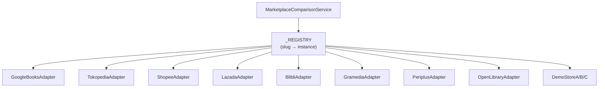

# 08 — Paket `app/services/marketplace/` (+ `adapters/`)

`app/services/marketplace/` membandingkan harga satu buku di banyak marketplace.
Paket ini adalah contoh **pewarisan + polimorfisme + registry** yang paling jelas
di proyek: satu ABC (`MarketplaceAdapter`) dan belasan subclass; service
orkestrasi tidak tahu apa-apa tentang Tokopedia atau Shopee secara spesifik.

---

## 1. Struktur (fakta)

| Berkas | Baris | Simbol utama | Tanggung jawab |
|--------|------:|--------------|----------------|
| `__init__.py` | — | Re-export `MarketplaceAdapter`, `FetchResult`, `build_client`, `normalize_price`, `title_similarity`, `get_adapter`, `marketplace_label`, `supported_marketplaces`, `MarketplaceComparisonService`, `build_service` | Antarmuka paket |
| `base.py` | 453 | `AdapterError(RuntimeError)`, `FetchResult`, `normalize_price`, `title_similarity`, `MarketplaceAdapter(ABC)`, `build_client` + util JSON-LD/meta (`_HeadParser`, `_Candidate`, `_walk_json_ld`, ...) | Kontrak adapter + util bersama |
| `adapters/catalog.py` | — | `TokopediaAdapter`, `ShopeeAdapter`, `LazadaAdapter`, `BlibliAdapter`, `GramediaAdapter`, `PeriplusAdapter`, `GoogleBooksAdapter`, `OpenLibraryAdapter` | Satu kelas per marketplace |
| `adapters/demo.py` | — | `DemoStoreAdapter`, `DemoStoreAAdapter`, `DemoStoreBAdapter`, `DemoStoreCAdapter` + `_digest`, `_price_for` | Adapter demo deterministik (tanpa jaringan) |
| `registry.py` | 105 | `ADAPTER_CLASSES`, `DEMO_CLASSES`, `_REGISTRY`, `get_adapter`, `marketplace_label`, `supported_marketplaces` | Satu tempat yang tahu adapter mana tersedia |
| `service.py` | 528 | `MarketplaceComparisonService`, `build_service`, konstanta cache/backoff | Orkestrasi: sumber admin + snapshot cache + riwayat |
| `scraper_client.py` | 187 | `ScraperServiceClient` | Klien layanan scraper eksternal (opsional) |
| `filtering.py` | 158 | fungsi penyaring kandidat harga | Aturan saring sebelum dipilih |
| `deterministic_validator.py` | 466 | `clean_tokens`, `extract_isbns`, `is_valid_http_url`, `detect_attributes`, `validate_basic_data`, `calculate_price_statistics`, `evaluate_candidate_deterministically`, ... | Validasi harga berbasis aturan (tanpa AI) |
| `ai_price_validator.py` | 271 | `AIPriceValidator`, `_build_cache_key`, `_sanitize_for_prompt` | Validasi harga dengan LLM OpenRouter + cache |
| `decision_engine.py` | 341 | `PriceValidationEngine` | Menggabungkan hasil deterministik + AI menjadi keputusan |
| `seeding.py` | 63 | fungsi penyemai sumber default | Dipakai saat buku dibuat (`books.py`) |

---

## 2. Kontrak `MarketplaceAdapter` (fakta)

```python
# app/services/marketplace/base.py
class MarketplaceAdapter(ABC):
    slug: str = ""
    label: str = ""
    match_threshold: float = MATCH_THRESHOLD

    @abstractmethod
    def build_search_url(self, keyword: str) -> str: ...

    def parse(self, text: str, page_url: str) -> list[_Candidate]:
        """Default: JSON-LD dulu, lalu meta tag Open Graph."""

    def pick_best(self, book_title: str, candidates: list[_Candidate]) -> tuple[_Candidate, float]: ...

    async def fetch(self, client, *, book_title, keyword, product_url=None) -> FetchResult: ...
```

**Hanya `build_search_url`** yang abstrak. `parse`, `pick_best`, dan `fetch` konkret — pola *template method*: alur "tentukan URL → ambil → baca →
pilih terbaik" ditulis sekali. Subclass meng-override `parse` bila responsnya
bukan HTML (mis. `GoogleBooksAdapter`) atau menaikkan `match_threshold` bila
judul marketplace berantakan. `match_threshold` default `MATCH_THRESHOLD = 0.55`.

Docstring `fetch` menjelaskan aturan: `product_url` dari admin menang atas
pencarian dan **tidak** dicek ambang kemiripan; pencarian otomatis wajib lolos
ambang.

**[Evaluasi]** Desain ini menerapkan *Open/Closed* secara nyata: menambah
marketplace = menambah kelas + mendaftarkannya di `ADAPTER_CLASSES`.

### Catatan LSP (`OpenLibraryAdapter`)
**[Fakta]** OpenLibrary tidak menyediakan harga jual. Docstring adapter
menjelaskan itu dan `parse` sengaja melempar:

```python
# app/services/marketplace/adapters/catalog.py
class OpenLibraryAdapter(MarketplaceAdapter):
    def parse(self, text: str, page_url: str) -> list[_Candidate]:
        raise AdapterError(
            "Open Library tidak menyediakan harga jual, hanya metadata buku."
        )
```
**[Fakta]** Alasan tertulis: mengembalikan `[]` akan menghasilkan pesan generik
yang menyiratkan harga ada tetapi gagal dibaca. Tes:
`test_open_library_refuses_to_invent_a_price`.

**[Evaluasi]** Secara *Liskov*, adapter ini melempar error untuk kasus normalnya.
Itu keputusan jujur (lebih baik daripada mengarang harga), tetapi konsumen harus
memperlakukan error adapter sebagai "tidak ada harga dari marketplace ini", bukan
kegagalan total — dan itu memang yang dilakukan service (`test_open_library_failure_becomes_a_warning_not_a_broken_comparison`).

---

## 3. Registry (fakta)

```python
# app/services/marketplace/registry.py
ADAPTER_CLASSES: tuple[type[MarketplaceAdapter], ...] = (
    GoogleBooksAdapter, TokopediaAdapter, ShopeeAdapter, LazadaAdapter,
    BlibliAdapter, GramediaAdapter, PeriplusAdapter, OpenLibraryAdapter,
)
DEMO_CLASSES: tuple[type[MarketplaceAdapter], ...] = (
    DemoStoreAAdapter, DemoStoreBAdapter, DemoStoreCAdapter,
)
_REGISTRY: dict[str, MarketplaceAdapter] = {
    adapter_class.slug: adapter_class()
    for adapter_class in (*ADAPTER_CLASSES, *DEMO_CLASSES)
}
```
**[Fakta]** Registry menyimpan **instance**, bukan kelas, karena adapter tidak
punya state. Adapter demo tidak muncul di dropdown admin (`supported_marketplaces()`),
tetapi tetap bisa dipanggil `get_adapter` sehingga data contoh lama tetap terbaca.



---

## 4. `MarketplaceComparisonService` (fakta)

**[Fakta]** Mengikuti "bentuk keempat" di docstring `app/services/__init__.py` —
service **ber-ketergantungan**:

```python
def __init__(
    self,
    source_repo: Any,
    price_repo: Any,
    *,
    cache_ttl: timedelta = DEFAULT_CACHE_TTL,
    clock: Callable[[], datetime] = _utcnow,
    client_factory: Callable[[], httpx.AsyncClient] = build_client,
    scraper_client: ScraperServiceClient | None = None,
    validation_engine: PriceValidationEngine | None = None,
) -> None: ...
```
**[Fakta]** `sources` dan `prices` diekspos sebagai properti (read-only) karena
endpoint admin memang mengelola sumber langsung.

**[Fakta]** Disusun di `app/api/v1/marketplaces.py::comparison_service(db)`
dengan `build_service(OrmMarketplaceSourceRepository(db), OrmMarketplacePriceRepository(db))`;
tes meng-override dependency itu (`tests/test_marketplaces.py`, 1400 baris).

**[Evaluasi]** Injeksi `clock` dan `client_factory` membuat cache dan jaringan
bisa diuji tanpa menunggu waktu sungguhan.

---

## 5. Validasi harga: tiga lapis (fakta)

| Lapis | Berkas | Ciri |
|-------|--------|------|
| Aturan murni | `deterministic_validator.py` | Bersih/rapi, tanpa I/O; menguji ISBN, atribut produk, statistik harga |
| AI opsional | `ai_price_validator.py` | OpenRouter + cache (`_build_cache_key`), sanitasi prompt (`_sanitize_for_prompt`) untuk tahan *prompt injection* |
| Keputusan | `decision_engine.py` | `PriceValidationEngine` menggabungkan keduanya; sistem tetap jalan bila AI tidak tersedia |

**[Fakta]** Diuji oleh `tests/test_price_validation.py` (25 skenario bernomor,
termasuk `test_24_marketplace_prompt_injection_defense` dan
`test_25_ui_and_system_works_when_ai_is_unavailable`).

---

## 6. Evaluasi & rekomendasi

| Aspek | Evaluasi | Rekomendasi |
|-------|----------|-------------|
| Slug | `MarketplaceSlug` adalah `Literal[...]` 11 nilai yang di-hard-code di `app/schemas/marketplace.py` (termasuk 3 `demo_store_*`); adapter katalog hanya 8 | Turunkan daftar dari `registry` agar menambah adapter tidak perlu menyentuh schema |
| `service.py` 528 baris | Menangani cache, backoff, scraper, riwayat, peringatan | Ekstrak kebijakan cache/backoff ke modul kecil bila bertambah |
| `seeding.py` hanya 63 baris | Ketergantungan `books.py` → paket ini (lewat `marketplace_repository.py`) | Dokumentasikan arah ketergantungan di doc 06 |
| Demo adapter | Deterministik, tanpa jaringan | Pertahankan; jangan sampai ikut ke production dropdown |

---

## 7. Kesimpulan

- **[Fakta]** Satu ABC, 11 adapter konkret, registry instance, satu service
  orkestrasi ber-DI, tiga lapis validasi harga.
- **[Evaluasi]** Paket dengan penerapan OOP paling terbuka dan paling teruji di
  backend; contoh terbaik *Open/Closed* proyek ini.
- **[Rekomendasi]** Selaraskan daftar slug schema dengan registry; jaga service
  tetap tipis dengan memindahkan kebijakan.
