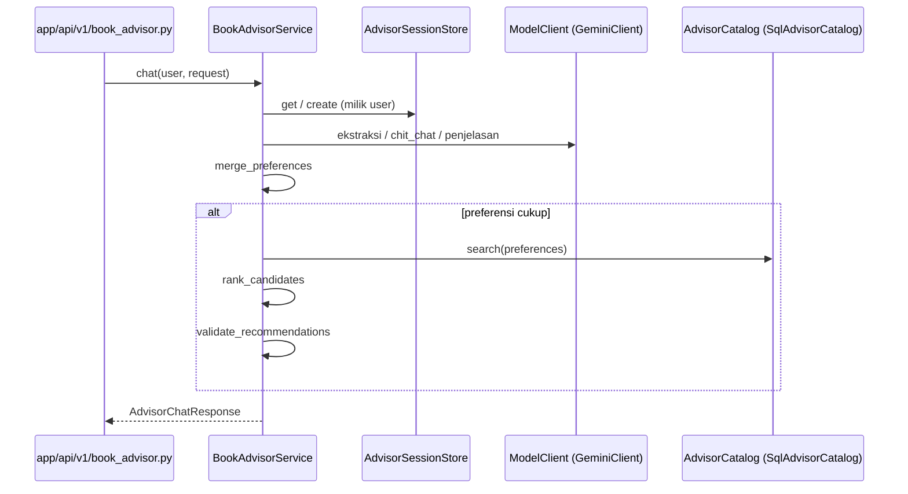

# 10 — Paket `app/services/advisor/`

`app/services/advisor/` adalah otak **AI Book Advisor**: percakapan untuk
merekomendasikan buku. Paket ini sengaja dibuat **tanpa query dan tanpa HTTP di
lapisan orkestrasi**: semuanya lewat kontrak yang disuntikkan
(`AdvisorCatalog`, `AdvisorSessionStore`, `ModelClient`), sehingga alurnya bisa
diuji tanpa database dan tanpa API berbayar.

---

## 1. Struktur (fakta)

| Berkas | Baris | Simbol utama | Tanggung jawab |
|--------|------:|--------------|----------------|
| `service.py` | 487 | `_TurnTracker`, `ModelClient` (`Protocol`), `BookAdvisorService`, `_looks_like_question`, `build_service`, konstanta `MAX_RECOMMENDATIONS = 5`, `MAX_CONTEXT_CANDIDATES = 10`, `PROVIDER_FAILED_NOTICE` | Orkestrasi satu giliran percakapan |
| `preferences.py` | 163 | `merge_preferences`, `missing_preferences`, `is_ready`, `parse_delta`, `delta_from_user_changes`, `merge_user_changes`, `_merge_list` | Model preferensi kumulatif; fungsi murni |
| `ranking.py` | 166 | `ScoredCandidate`, `topic_match`, `author_match`, `budget_match`, `rank_candidates` (+ `_haystack`, `_keyword_hit`) | Ranking kandidat berbobot |
| `validation.py` | 202 | `MAX_REPLY_LENGTH`, `MAX_REASON_LENGTH`, `MAX_QUESTION_LENGTH`, `small_talk_reply`, `heuristic_delta`, `validate_recommendations`, `parse_extraction`, `parse_explanation`, `_fallback_reason`, `_parse_budget` | Validasi keluaran model + fallback heuristik |
| `catalog.py` | 99 | `MAX_CANDIDATES = 200`, `AdvisorCatalog` (`Protocol`), `SqlAdvisorCatalog`, `candidate_ids`, `_excluded_ids` | Kandidat buku dari `AsyncSession` |
| `session.py` | 105 | `MAX_SESSIONS = 500`, `SESSION_TTL_SECONDS = 6 * 60 * 60`, `MAX_HISTORY_MESSAGES = 20`, `AdvisorSession`, `AdvisorSessionStore` (`Protocol`), `InMemoryAdvisorSessionStore` | Penyimpanan sesi (LRU + TTL) |
| `gemini.py` | 358 | `ADVISOR_SYSTEM_PROMPT`, `EXTRACTION_SCHEMA`, `EXPLANATION_SCHEMA`, `AdvisorModelError`, `GeminiClient`, `get_gemini_client`, `describe_candidate`, `_preferences_json`, `_truncated` | Klien Gemini (HTTP) |
| `__init__.py` | — | Docstring pembagian tanggung jawab per modul | Dokumentasi paket |

---

## 2. Alur satu giliran (fakta)

Docstring `service.py` — diverifikasi terhadap kode:

1. Muat sesi milik pengguna, atau buat baru bila `session_id` tidak dikirim /
   bukan miliknya.
2. Satu panggilan model, tergantung kondisi:
   - preferensi **belum cukup** → **ekstraksi**: delta preferensi + balasan + pertanyaan;
   - pesan hanya sapaan/obrolan (`chit_chat`) → balas natural, tanpa mencari buku;
   - preferensi **sudah cukup** → **penjelasan** atas kandidat pilihan backend.
3. Gabungkan delta ke profil kumulatif (`merge_preferences`).
4. Bila cukup: cari kandidat (`AdvisorCatalog.search`), ranking
   (`rank_candidates`), validasi keluaran model terhadap kandidat tersebut
   (`validate_recommendations`).



**[Fakta]** Status percakapan (`conversation_state`) diputuskan **backend**,
bukan model.

**[Fakta]** `_TurnTracker` (dataclass) mencatat `model_calls`,
`model_succeeded`, dan `provider_failed` per giliran: giliran dianggap dilayani
AI bila **setidaknya satu** panggilan berhasil; `provider_failed` hanya bila
provider dikonfigurasi tetapi semua panggilan gagal. Nilai inilah yang dipakai
router untuk memutuskan penagihan/refund.

---

## 3. Pola desain (fakta)

### a. Tiga `Protocol` sebagai kontrak
```python
# app/services/advisor/service.py
class ModelClient(Protocol):
    @property
    def is_configured(self) -> bool: ...
    async def complete_json(self, messages: list[dict[str, str]]) -> dict[str, Any]: ...

# app/services/advisor/catalog.py
class AdvisorCatalog(Protocol):
    async def search(self, preferences: BookPreferences, *, limit: int = MAX_CANDIDATES) -> list[CandidateBook]: ...

# app/services/advisor/session.py
class AdvisorSessionStore(Protocol):
    def create(self, user_id: str) -> AdvisorSession: ...
    def get(self, session_id: uuid.UUID, user_id: str) -> AdvisorSession | None: ...
```
**[Evaluasi]** Tiga `Protocol` struktural membuat `BookAdvisorService` bisa
diuji penuh dengan fake (`tests/test_book_advisor.py`: `FakeCatalog`,
`FakeModel`, `FailingModel`) tanpa DB/Gemini.

### b. Fungsi murni untuk aturan
`preferences.py`, `ranking.py`, dan `validation.py` hampir seluruhnya fungsi
murni. Rank dibobot hanya untuk sinyal yang tersedia
(`test_ranking_only_divides_weights_for_available_signals`), tie-break harga
lalu judul.

### c. Kejujuran keluaran model
**[Fakta]** Skor **tidak pernah** berasal dari model
(`test_score_never_comes_from_model`); kandidat ID diambil dari repository
(`test_candidate_ids_only_contains_repository_ids`); bila model gagal, backend
jatuh ke kandidat hasil ranking (`test_model_failure_falls_back_to_ranked_candidates`).

### d. Keamanan sesi
**[Fakta]** `InMemoryAdvisorSessionStore.get` menuntut `user_id` pemilik; sesi
orang lain diperlakukan "tidak ditemukan" (`test_other_users_session_is_not_readable`).
LRU `MAX_SESSIONS = 500`, TTL `6` jam, riwayat `MAX_HISTORY_MESSAGES = 20`.

---

## 4. Penagihan (fakta)

**[Fakta]** Paket ini **tidak** memanggil `RewardsService`; penagihan dilakukan
di router (`app/api/v1/book_advisor.py`) dengan:
`rewards_service.advisor_message_cost()` → `charge_advisor_message(...)` →
bila provider gagal `refund_advisor_message(...)`.

**[Evaluasi]** Pemisahan orkestrasi percakapan vs penagihan jelas dan diuji
terpisah (`tests/test_advisor_billing.py`, 556 baris).

---

## 5. Evaluasi & rekomendasi

| Aspek | Evaluasi | Rekomendasi |
|-------|----------|-------------|
| Sesi in-memory | Hilang saat restart; tidak berbagi antar instance | Untuk multi-instance, pindahkan ke Postgres/Redis di balik `AdvisorSessionStore` (kontraknya sudah siap) |
| `gemini.py` 358 baris | HTTP + prompt + skema JSON dalam satu berkas | Tipiskan bila prompt bertambah; skema JSON bisa dipindah ke berkas terpisah |
| `service.py` 487 baris | Masih terbaca; tanggung jawab terjaga | Pertahankan |
| Docstring paket | `advisor/__init__.py` sudah menjelaskan pembagian per modul | Pertahankan pola ini di paket lain |

---

## 6. Kesimpulan

- **[Fakta]** Tujuh modul: orkestrasi (`service.py`), tiga kontrak `Protocol`,
  tiga modul fungsi murni, satu klien HTTP (`gemini.py`).
- **[Evaluasi]** Contoh terbaik *Dependency Inversion* di backend: total fake-able.
- **[Rekomendasi]** Ganti store in-memory bila deploy multi-instance; sisanya
  sudah sehat.
