# 11 — `migrations/` dan `supabase/`

`migrations/` adalah **satu-satunya jalur migrasi resmi** skema database
(Alembic). `supabase/` adalah **arsip historis** yang menurut README-nya sendiri
tidak boleh dijalankan ke database produksi.

> **[Fakta]** (memori proyek) Database live Supabase **bukan** hasil
> `supabase/*.sql`, dan beberapa objeknya berbeda dari repositori. Alembic adalah
> acuan. Dokumen ini hanya mendeskripsikan isi repositori; tidak ada perintah
> database yang dijalankan.

---

## 1. Struktur

| Path | Isi |
|------|-----|
| `migrations/env.py` | Menyusun engine async dari `settings.database_url`, `target_metadata = Base.metadata`, mengimpor `app.models` agar semua tabel terdaftar |
| `migrations/script.py.mako` | Template revisi baru |
| `migrations/versions/*.py` | **13 revisi** berurutan |
| `alembic.ini` | `script_location = %(here)s/migrations`, `sqlalchemy.url` tanpa kredensial (diisi dari `settings`) |
| `supabase/README.md` | Peringatan: folder basi, jangan dipakai |
| `supabase/migrations/0001_init.sql`, `0002_rls.sql`, `0003_functions.sql` | Arsip SQL lama |
| `supabase/seed.sql` | Seed lama |

---

## 2. Rantai revisi (fakta)

```mermaid
flowchart LR
    R01["20260928_01<br/>profiles"] --> R02["20260928_02<br/>books"]
    R02 --> R03["20260928_03<br/>promos"]
    R03 --> R04["20261011_04<br/>RBAC/RLS"]
    R04 --> R05["20261011_05<br/>is_admin()"]
    R05 --> R06["20261011_06<br/>identifier profil"]
    R06 --> R07["20261015_07<br/>tabel marketplace"]
    R07 --> R08["20261015_08<br/>slug demo + source mock"]
    R08 --> R09["20261018_09<br/>Bukalapak → Gramedia/Periplus"]
    R09 --> R10["20261019_10<br/>tabel community"]
    R10 --> R11["20261019_11<br/>Book Rewards"]
    R11 --> R12["20261020_12<br/>biaya chat advisor"]
    R12 --> R13["20261024_13<br/>verifikasi pembayaran"]
```

| Revisi | Judul | Objek utama |
|--------|-------|-------------|
| `20260928_01` | Create profiles | Tabel `profiles` terhubung `auth.users`, trigger pembuatan profil saat signup, RLS |
| `20260928_02` | Create books | Tabel `books` (judul, pengarang, ISBN, harga, stok) |
| `20260928_03` | Create promos | Tabel `promos` (tipe diskon, rentang tanggal, kuota) |
| `20261011_04` | RBAC/RLS | Menutup celah tulis browser, policy admin, perbaikan trigger profil (merujuk `is_admin()` dan tabel `categories`) |
| `20261011_05` | `is_admin()` | Fungsi SQL `public.is_admin()` (`STABLE SECURITY DEFINER`) |
| `20261011_06` | Identifier profil | Kolom `username`, `full_name`, `avatar_url` |
| `20261015_07` | Tabel marketplace | `marketplace_sources`, `marketplace_prices` |
| `20261015_08` | Slug demo | Longgarkan CHECK untuk `demo_store_a/b/c` dan `source='mock'` |
| `20261018_09` | Ganti Bukalapak | Slug Bukalapak diganti Gramedia dan Periplus |
| `20261019_10` | Tabel community | `chat_groups`, `chat_group_members`, `chat_messages`; RLS SELECT-only; publikasi `supabase_realtime` via blok DO |
| `20261019_11` | Book Rewards | `reviews`, kolom moderasi + `chat_message_helpful_marks`, `point_transactions`, `profiles.points`, `reward_rules`, `reward_rules_audit`, `ai_review_generations`, RPC `apply_point_transaction` dan `set_reward_rules`, trigger `prevent_points_tampering`, `guard_reward_rules_write` |
| `20261020_12` | Biaya chat advisor | Aturan `advisor_message_points` (default 10); tipe transaksi `ai_chat_charge` dan sumber `ai_chat` |
| `20261024_13` | Verifikasi pembayaran | Kolom verifikasi di `payments`, `payment_proofs`, unique index parsial `uq_payment_proofs_one_pending`, `payment_audit_logs` |

**[Fakta]** Docstring revisi rata-rata berisi bagian *Latar belakang*, *Keamanan*,
*Kompatibilitas data lama*, dan *Penerapan* — tingkat dokumentasi yang tinggi.

---

## 3. Temuan penting (fakta)

### a. Rantai tidak bisa membangun DB kosong (04)
**[Fakta]** Revisi `20261011_04` merujuk `is_admin()` yang baru dibuat di
`20261011_05`, dan merujuk tabel `categories` yang **tidak pernah** dibuat oleh
revisi mana pun. Revisi 11 juga mencatat di docstringnya:

> "rantai alembic dari revisi 04 tidak dapat membangun DB kosong (lihat memori
> proyek); live DB adalah acuan."

**[Evaluasi]** Konsekuensinya, `alembic upgrade head` di database kosong gagal;
migrasi hanya bisa diterapkan bertahap ke DB live yang sudah ada.

**[Rekomendasi]** *(butuh persetujuan DB — belum dilakukan)*:
1. Buat revisi baru yang membuat `categories` (atau dokumentasikan bahwa tabel
   itu dikelola manual di live).
2. Geser pembuatan `is_admin()` sebelum revisi 04 (revisi baru dengan
   `down_revision` yang tepat, atau devinisikan ulang fungsi di awal 04).
3. Uji dengan `alembic upgrade head` di database kosong (lokal/Docker) sebelum
   menyentuh live.

### b. Docstring revisi 12 (sudah dikoreksi 2026-10-30)
**[Fakta]** Revisi 12 semula menulis: *"migrasi ini **belum** diterapkan ke
database live"*, padahal memori proyek mencatat live DB sudah di `20261024_13`
(artinya revisi 12 sudah jalan). Kalimat itu sudah diganti dengan catatan bahwa
dokumen ditulis sebelum penerapan dan migrasi sudah diterapkan. Hanya teks
docstring yang berubah; DDL tidak disentuh.

### c. Bucket Storage bukan bagian migrasi
**[Fakta]** Revisi 13 menjelaskan bahwa bucket privat `payment-proofs` dibuat
terpisah di Dashboard/SQL Editor, bukan oleh migrasi. Skrip pemeriksaan manual
ada di `scripts/smoke_payment_bucket.py` (doc 12).

**[Evaluasi]** Wajar (Alembic tidak mengelola Storage), tetapi memerlukan
langkah manual di setiap lingkungan baru.

### d. Model vs migrasi
**[Fakta]** Lihat doc 04: `TRANSACTION_TYPES` di `app/models/rewards.py` belum
memuat `ai_chat_charge`, dan check `moderation_status` ada di model tetapi kolom
barunya datang dari revisi 11.

---

## 4. `supabase/` — arsip (fakta)

README folder:

> "Folder ini **basi** dan **bukan** sumber kebenaran skema. Jangan jalankan
> `supabase db push` ... Jalur migrasi resmi: **Alembic**."

Isi arsip menurut README-nya memakai skema lama: tabel `products`, enum
`user_role`, fungsi `is_staff_or_admin()`, policy `customer_id` — semuanya tidak
cocok dengan DB live. `0002_rls.sql` pernah menjadi satu-satunya sumber
`is_admin()`; sekarang dibuat oleh revisi `20261011_05`.

**[Fakta]** `supabase/migrations/0003_functions.sql` berisi `adjust_stock`,
`update_order_status`, `dashboard_summary`, `sales_timeseries` (SQL) dan view
`low_stock_products`. Tidak satu pun dari objek itu dibuat oleh revisi alembic
mana pun (tidak muncul di `migrations/versions/`).

**[Evaluasi]** Bila fungsi/view itu masih dipakai di live, keberadaannya
bergantung pada penerapan manual — risiko "skema tidak tercatat di repositori".

**[Rekomendasi]** Verifikasi langsung di live (butuh izin) apakah fungsi-fungsi
itu masih ada dan dipakai; bila ya, pindahkan definisinya ke revisi alembic baru.

**[Rekomendasi]** Jangan hapus (aturan tugas: jangan hapus berkas). Cukup
pertahankan peringatan README.

---

## 5. Kesimpulan

- **[Fakta]** 13 revisi berurutan dan terdokumentasi; `supabase/` ditandai
  sebagai arsip.
- **[Evaluasi]** Kualitas docstring tinggi; masalah utama adalah ketidakmampuan
  membangun DB kosong dari awal.
- **[Rekomendasi]** Perbaiki rantai hanya setelah disetujui pemilik DB, dan uji
  di DB kosong terlebih dahulu.
