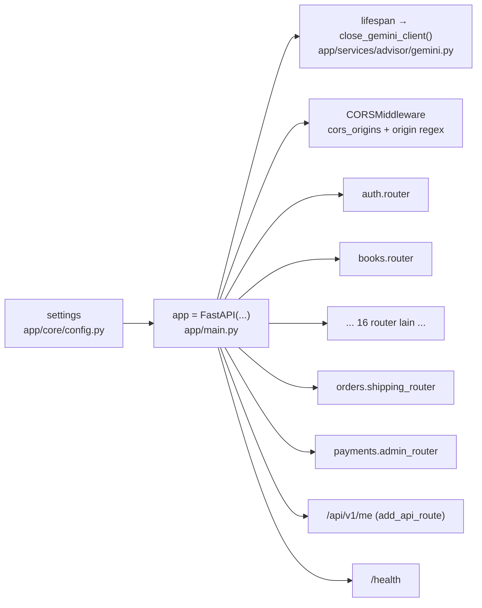

# 13 — `app/main.py` dan `app/__init__.py`

`app/main.py` adalah **titik rakit** aplikasi FastAPI: membuat objek `app`,
memasang middleware CORS, mendefinisikan `lifespan`, dan mendaftarkan semua
router `/api/v1`. `app/__init__.py` hanya berisi docstring paket.

---

## 1. Isi `app/main.py` (fakta)

| Bagian | Kode (potongan nyata) | Penjelasan |
|--------|-----------------------|------------|
| `lifespan` | `async def lifespan(_app: FastAPI): ... await close_gemini_client()` | Menutup klien HTTP Gemini di event loop yang sama saat shutdown (docstring menjelaskan kenapa `atexit` tidak dipakai). |
| `FastAPI(...)` | `title=settings.PROJECT_NAME`, `openapi_url=f"{settings.API_V1_PREFIX}/openapi.json"`, `docs_url="/docs"`, `redoc_url="/redoc"`, `lifespan=lifespan` | Konfigurasi dasar dari `Settings`. |
| CORS | `_DEV_LAN_ORIGIN_REGEX`, `_origin_regexes`, `_ORIGIN_REGEX` lalu `app.add_middleware(CORSMiddleware, allow_origins=settings.cors_origins, allow_origin_regex=_ORIGIN_REGEX, allow_credentials=True, allow_methods=[...], allow_headers=["Authorization", "Content-Type", "Accept"])` | Regex dev LAN hanya aktif di `development` (`settings.dev_lan_origins_trusted`); regex Vercel dari `settings.vercel_origins_regex`. |
| Router | `app.include_router(auth.router, prefix=settings.API_V1_PREFIX)` ... (19 baris) | Termasuk `orders.shipping_router`, `payments.admin_router`, `admin_rewards.router`. |
| Alias | `app.add_api_route(f"{settings.API_V1_PREFIX}/me", auth.get_my_profile, methods=["GET"], tags=["Autentikasi"])` | Kompatibilitas klien frontend. |
| Health | `@app.get("/health")` → `health_check()` | Mengembalikan `status`, `pesan`, `environment` dari `settings.ENVIRONMENT`. |

**[Fakta]** Urutan `include_router` menentukan urutan daftar endpoint di OpenAPI,
bukan routing (FastAPI mencocokkan path apa pun urutannya).

---

## 2. Diagram rakit (fakta)

---

## 3. Pola OOP & desain (fakta)

### a. Komposisi aplikasi
**[Fakta]** `app/main.py` **tidak** berisi class aplikasi kustom. Ia mengomposisikan
objek `FastAPI` dari bagian-bagian terpisah (router). Ini pola komposisi, bukan
pewarisan: tidak ada `class MyApp(FastAPI)`.

**[Evaluasi]** Tepat untuk proyek ini — subclass `FastAPI` hanya menambah lapisan
tanpa manfaat.

### b. `lifespan` sebagai context manager
**[Fakta]** `@contextlib.asynccontextmanager` menyediakan kode sebelum `yield`
(startup) dan sesudahnya (shutdown). Saat ini hanya shutdown yang dipakai
(menutup klien Gemini).

### c. Konfigurasi dari satu sumber
**[Fakta]** Semua nilai (`API_V1_PREFIX`, `PROJECT_NAME`, CORS, environment)
berasal dari `settings`; tidak ada string literal lingkungan di berkas ini.

---

## 4. Evaluasi & rekomendasi

| Aspek | Evaluasi | Rekomendasi |
|-------|----------|-------------|
| CORS | Regex dev LAN dibangun dari IP privat; di production hanya daftar eksplisit. Alasan ditulis di komentar. | Pertimbangkan tes yang memastikan regex dev **tidak** ikut di production (lihat `tests/test_cors.py`). |
| `health_check` | Statis (`"status": "online"`); tidak memeriksa DB/PostgREST. | Bila dipakai uptime monitor sungguhan, tambahkan cek ringan (mis. query `select 1`) dengan timeout pendek. |
| Alias `/me` | Ditambahkan tanpa docstring endpoint baru | Beri docstring singkat agar muncul di `/docs`. |
| Daftar router | 19 baris `include_router` eksplisit | Bisa diurai otomatis dari paket, tetapi daftar eksplisit lebih mudah dibaca dan lebih aman — pertahankan. |

**[Rekomendasi]** Tidak ada perubahan mendesak di berkas ini; kualitasnya sudah
baik dan terdokumentasi.

---

## 5. Kesimpulan

- **[Fakta]** `app/main.py` ±123 baris: objek `FastAPI`, CORS, `lifespan`,
  router, alias, `/health`.
- **[Evaluasi]** Satu berkas rakit, tidak ada logika bisnis.
- **[Rekomendasi]** Pertahankan pola ini; tambahkan docstring pada alias `/me`.
