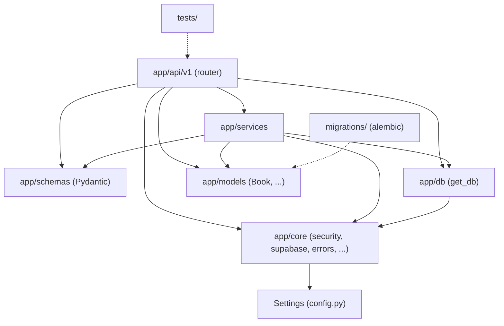

# Penjelasan per Paket — Backend Sistem Toko Buku

Dokumen ini adalah indeks untuk penjelasan **per paket/folder** di `backend/`.
Setiap berkas di folder ini menjelaskan **posisi, tanggung jawab, isi, dan
relasi** paket yang bersangkutan, ditambah **tabel per file** (tujuan, simbol
utama, siapa yang memakainya).

> Bagaimana membaca dokumen ini
> - **[Fakta]** — perilaku yang dapat diverifikasi langsung dari kode.
> - **[Evaluasi]** — penilaian penulis dokumen terhadap kode tersebut.
> - **[Rekomendasi]** — usulan perbaikan. **Tidak ada kode yang diubah** untuk
>   menyusun dokumen ini.
> - Path file selalu relatif terhadap direktori `backend/`.
> - Tidak ada nilai rahasia (key/token/password) yang ditampilkan; hanya nama
>   variabel konfigurasi.

Untuk penjelasan konsep OOP dan SOLID secara menyeluruh (lintas paket), lihat
[`../OOP_IMPLEMENTATION.md`](../OOP_IMPLEMENTATION.md).

---

## Daftar dokumen

| # | Dokumen | Paket yang dibahas |
|---|---------|--------------------|
| 0 | [00-root.md](00-root.md) | Berkas di akar `backend/` (entrypoint, konfigurasi build/deploy, dokumen) |
| 1 | [01-api.md](01-api.md) | `api/`, `app/api/`, `app/api/v1/` |
| 2 | [02-core.md](02-core.md) | `app/core/` |
| 3 | [03-db.md](03-db.md) | `app/db/` |
| 4 | [04-models.md](04-models.md) | `app/models/` |
| 5 | [05-schemas.md](05-schemas.md) | `app/schemas/` |
| 6 | [06-services.md](06-services.md) | `app/services/` (level atas) |
| 7 | [07-services-community.md](07-services-community.md) | `app/services/community/` |
| 8 | [08-services-marketplace.md](08-services-marketplace.md) | `app/services/marketplace/` + `adapters/` |
| 9 | [09-services-rewards.md](09-services-rewards.md) | `app/services/rewards/` |
| 10 | [10-services-advisor.md](10-services-advisor.md) | `app/services/advisor/` |
| 11 | [11-migrations-supabase.md](11-migrations-supabase.md) | `migrations/`, `alembic.ini`, `supabase/` |
| 12 | [12-tests.md](12-tests.md) | `tests/`, `scripts/` |
| 13 | [13-app-main.md](13-app-main.md) | `app/main.py`, `app/__init__.py` |

---

## 1. Peta folder (fakta)

```
backend/
├── main.py                  # uvicorn runner lokal
├── api/index.py             # entrypoint Vercel (serverless)
├── app/
│   ├── main.py              # objek FastAPI: CORS, lifespan, include_router
│   ├── api/v1/              # 18 modul router  → doc 01
│   ├── core/                # config, security, supabase, errors, clock, shipping, uploads → doc 02
│   ├── db/                  # Base, engine, get_db → doc 03
│   ├── models/              # model SQLAlchemy (ORM) → doc 04
│   ├── schemas/             # model Pydantic (request/response) → doc 05
│   └── services/            # layer bisnis + repository → doc 06
│       ├── community/       #   → doc 07
│       ├── marketplace/     #   → doc 08 (adapters/ di dalamnya)
│       ├── rewards/         #   → doc 09
│       └── advisor/         #   → doc 10
├── migrations/              # Alembic → doc 11
├── supabase/                # SQL awal (legacy) → doc 11
├── tests/                   # pytest → doc 12
├── scripts/                 # skrip manual → doc 12
└── docs/                    # dokumen (OOP_IMPLEMENTATION.md + folder ini)
```

## 2. Arah ketergantungan antar paket (fakta)



Aturan yang **benar-benar** dipatuhi kode (dicek dengan membaca impor):

- **[Fakta]** `app/core` **tidak** mengimpor `app/services`, `app/api`, atau
  `app/models`. Ini paket paling bawah.
- **[Fakta]** `app/services` **tidak** mengimpor FastAPI (bukan `HTTPException`);
  kesalahan domain diterjemahkan ke HTTP hanya di `app/api/v1`. Contoh bukti:
  `app/services/community/errors.py` mendefinisikan `CommunityError` yang
  kemudian dipetakan oleh `_http()` di `app/api/v1/community.py`.
- **[Fakta]** `app/models` hampir seluruhnya mandiri; hanya `app/models/__init__.py`
  diimpor oleh `app/api/v1/books.py` dan `app/services/*repository*.py`.
- **[Evaluasi]** Ada satu impor "naik" dari paket UI-flavored ke app
  (`app/api/v1/marketplaces.py` mengimpor `DB_UNREACHABLE` dan
  `load_book_for_read` dari `app/api/v1/books.py`). Tidak salah, tetapi membuat
  router saling bergantung — lihat doc 01 §Evaluasi.

## 3. Dua jalur akses data (fakta)

Backend ini membaca/menulis data lewat **dua jalur berbeda**, dan hampir setiap
paket service memilih salah satunya:

| Jalur | Klien/objek | Paket yang memakai | Konsekuensi |
|-------|-------------|--------------------|-------------|
| PostgREST (Supabase REST) | `supabase_admin` / `supabase_anon` di `app/core/supabase.py` | `category_service`, `promo_service`, `cart_service`, `order_service`, `inventory_service`, `dashboard_service`, `payment_service`, `rewards/repository.py`, `book_service.RestBookRepository`, `auth.py` | Tidak ada model ORM; data berupa `dict`. RLS dilewati oleh klien service-role → otorisasi wajib di layer API. |
| SQLAlchemy async | `AsyncSession` dari `get_db` (`app/db/session.py`) | `books.py` (jalur utama), `community/`, `reviews/`, `marketplace_repository.py`, `advisor/catalog.py`, `marketplace.py` | Ada model ORM (`app/models`), transaksi eksplisit `commit()`. |

> **[Fakta]** Docstring `app/db/session.py` dan `app/db/__init__.py` sebelumnya
> menyebut jalur SQLAlchemy "hanya dipakai endpoint `books`". Itu tidak lagi
> akurat (`community`, `reviews`, `marketplace`, `advisor` juga memakainya) dan
> **sudah diperbarui pada 2026-10-30** — kini keduanya mendaftar jalur ORM vs
> PostgREST beserta pemakainya.

## 4. Konvensi yang berlaku lintas paket (fakta)

| Konvensi | Contoh | Dokumen |
|----------|--------|---------|
| Satu `APIRouter` per modul, didaftarkan di `app/main.py` | `router = APIRouter(prefix="/categories", ...)` | 01, 13 |
| Envelope respons `ApiResponse[T]` / `PaginatedResponse[T]` | `app/schemas/common.py` | 05 |
| Alias tipe dependency `Db`, `CurrentUser`, `GroupSvc`, ... | `Db = Annotated[AsyncSession, Depends(get_db)]` | 01, 03 |
| Error domain → HTTP di router, bukan di service | `CommunityError` + `_http()` | 06, 07 |
| Singleton modul untuk service tanpa state | `category_service = CategoryService()` | 06 |
| Fungsi provider `Depends` untuk service yang butuh sesi DB | `comparison_service(db)`, `get_group_service(db)` | 01, 08 |
| Fungsi murni untuk aturan domain | `permissions.py`, `advisor/ranking.py`, `rewards/access.py` | 07, 09, 10 |

---

## 5. Ringkasan evaluasi per paket

| Paket | Kekuatan | Titik lemah |
|-------|----------|-------------|
| `app/api/v1` | Router tipis, otorisasi terbaca dari berkasnya, error dipetakan seragam | Router `marketplaces.py` mengimpor helper dari `books.py`; satu modul (community, books) menangani banyak resource |
| `app/core` | Konfigurasi terpusat, JWT di satu tempat, `SERVICE_ERRORS` sempit | `supabase_admin` berupa global (sulit diganti di tes tanpa monkeypatch) |
| `app/db` | `get_db` generator sederhana, `NullPool` untuk serverless | Daftar pemakai di docstring harus ikut diperbarui saat pemakai baru muncul (lihat §3) |
| `app/models` | Model dipisah per domain | Sebagian tabel hanya lewat PostgREST → tidak ada model (disengaja, terdokumentasi) |
| `app/schemas` | Validasi kuat, generik PEP 695 | Beberapa schema besar (community, book_advisor) |
| `app/services` | Perbedaan "CRUD satu tabel" vs "orkestrasi stateless" terdokumentasi | `InventoryService`/`PaymentService`/`OrderService` sangat besar (400–600 baris) |
| `community/` | Izin murni, error domain, repository ORM rapi | Belum ada ABC untuk repository (konsistensi dengan `BookRepository`) |
| `marketplace/` | Adapter + registry polimorfik, validator deterministik teruji | Slug di-hard-code sebagai `Literal` di schema |
| `rewards/` | Ledger via `Protocol`, kode error mesin | `service.py` ±870 baris |
| `advisor/` | Pemisahan preferensi/ranking/katalog/sesi yang jelas | Sesi in-memory per proses |
| `migrations/` | Rantai alembic jelas | Rantai tidak bisa membangun DB kosong dari nol (lihat doc 11) |
| `tests/` | Banyak perilaku diuji, ada `test_oop_contracts.py` | Sebagian bergantung pada monkeypatch global |
